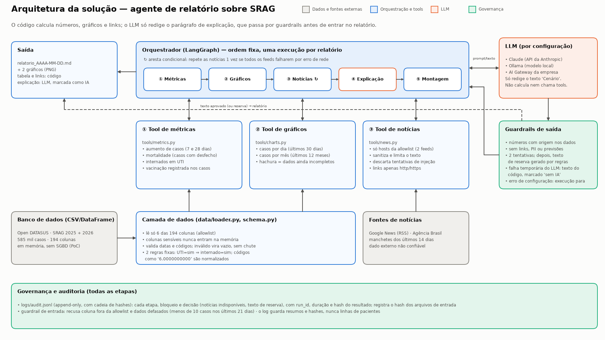

# Agente de relatório sobre SRAG

Prova de conceito (PoC) da Indicium HealthCare Inc.: um agente que consulta os dados de internações por
Síndrome Respiratória Aguda Grave (SRAG) do Open DATASUS, calcula quatro métricas, gera dois gráficos,
busca notícias recentes e produz um relatório em Markdown com uma explicação do cenário.

> **Princípio central:** o código calcula todos os números, gráficos, tabelas e links. O LLM só redige o
> parágrafo de explicação, e esse texto passa por guardrails antes de entrar no relatório.

## Desvios em relação ao enunciado

- **Volume dos dados.** O enunciado descreve cerca de 100 colunas e 165 mil linhas. Os arquivos atuais do Open DATASUS
  têm 194 colunas, e as janelas móveis exigem o ano corrente e o anterior (2025 e 2026): 585.334 casos. Como a leitura
  usa uma allowlist de 6 colunas, o número de colunas não afeta o agente.
- **Ocupação de UTI** virou a proporção de internados em UTI, porque o conjunto não tem o número de leitos (decisão 4).
- **Vacinação da população** virou a proporção de vacinados entre os casos, porque o conjunto não tem a população
  (decisão 5).
- **Tempo real.** As notícias são buscadas por RSS a cada execução, mas o CSV é um arquivo atualizado
  periodicamente, não um fluxo contínuo.

## Arquitetura



Versão em PDF: [`docs/arquitetura.pdf`](docs/arquitetura.pdf). O diagrama é gerado por
[`docs/build_diagram.py`](docs/build_diagram.py).

| Componente | O que faz | Código |
|---|---|---|
| **Orquestrador** | Pipeline no LangGraph com ordem fixa: métricas → gráficos → notícias → explicação → montagem. Uma aresta condicional repete as notícias uma vez se todos os feeds falharem por erro de rede | `src/srag/agent/graph.py` |
| **Tool de métricas** | Aumento de casos, mortalidade, internados em UTI, vacinação registrada | `src/srag/tools/metrics.py` |
| **Tool de gráficos** | Casos por dia (30 dias) e por mês (12 meses) | `src/srag/tools/charts.py` |
| **Tool de notícias** | Manchetes via RSS, tratadas como dado não confiável | `src/srag/tools/news.py` |
| **Camada de dados** | Lê só 6 das 194 colunas do CSV e valida datas e códigos | `src/srag/data/` |
| **LLM** | Claude (API), Ollama (local) ou AI Gateway, escolhido por configuração | `src/srag/llm/factory.py` |
| **Governança** | Log de auditoria e guardrails de entrada e saída | `src/srag/governance/` |

O "banco de dados" desta PoC é o CSV do Open DATASUS carregado em memória (cerca de 585 mil casos de 2025 e 2026).
Para o volume atual isso é suficiente e dispensa um SGBD.

## Como rodar

Requer Python 3.12 em Linux, macOS ou WSL (o log de auditoria usa `fcntl`, que não existe no Windows puro).

```bash
python -m venv .venv
source .venv/bin/activate
pip install -r requirements.txt
```

**1. Dados.** Crie a pasta com `mkdir -p data/raw` (ela não é versionada) e baixe os CSVs de
[SRAG 2019 a 2026](https://dadosabertos.saude.gov.br/dataset/srag-2019-a-2026) para ela. Os arquivos precisam começar com `INFLUD` (por exemplo `INFLUD25-16-11-2026.csv`, em que `25`
é o ano dos dados e `16-11-2026` é a data da extração).

**Quais arquivos são necessários:** o ano corrente e o anterior, e nenhum outro. As janelas são móveis, e o gráfico
mensal olha 12 meses para trás, então ele cruza a virada de ano. Os arquivos são divididos por semana
epidemiológica, não por ano civil: o de 2025 vai até 03/01/2026, e o de 2026 começa em 04/01/2026. Os anos de
2019 a 2024 não entram em nenhuma métrica ou gráfico (seriam úteis só para comparar sazonalidade, o que está fora
do escopo). O ano em andamento não é problema: o arquivo do ano corrente é um "banco vivo", atualizado
periodicamente, e o corte de 14 dias trata os casos que ainda estão chegando. Para atualizar, baixe o arquivo
novo. Se houver dois snapshots do mesmo ano, o programa usa só o mais recente e registra no log quais ignorou;
ele não apaga nada.

**2. LLM.** Escolha o provedor por variável de ambiente.

```bash
# Opção A: Ollama (local, sem chave)
ollama pull qwen2.5:3b
export SRAG_LLM_PROVIDER=ollama
export SRAG_LLM_MODEL=qwen2.5:3b

# Opção B: Claude (API da Anthropic)
export SRAG_LLM_PROVIDER=anthropic
export ANTHROPIC_API_KEY=...   # defina no seu terminal; nunca coloque em arquivos do repositório

# Opção C: AI Gateway (Unity Gateway do Databricks, API compatível com a da OpenAI)
export SRAG_LLM_PROVIDER=gateway
export SRAG_LLM_MODEL=catalogo.schema.servico   # nome do serviço de modelo, obrigatório
export DATABRICKS_HOST=https://<seu-workspace>   # avisa se não for um domínio Databricks conhecido
export DATABRICKS_TOKEN=...    # defina no seu terminal; nunca coloque em arquivos do repositório
```

Em vez de digitar `export` toda vez, copie `env.example` para `.env` (já ignorado pelo git), preencha e carregue
no terminal com `set -a; source .env; set +a`. O programa lê apenas variáveis de ambiente e **não** carrega o `.env`
sozinho.

**3. Gerar o relatório.**

```bash
PYTHONPATH=src python -m srag.main
```

O relatório e os gráficos saem em `reports/` e a trilha de auditoria em `logs/audit.jsonl`.

**4. Testes** (não precisam de rede nem de LLM; usam um LLM simulado):

```bash
python -m pytest
```

**5. EDA das colunas (opcional).** Regera `docs/eda_colunas.md`. O script lê as 194 colunas em blocos e publica só
agregados, sem valores das colunas sensíveis:

```bash
PYTHONPATH=src python -m srag.data.profile docs/eda_colunas.md data/raw/INFLUD*.csv
```

## Métricas e definições

Todas as janelas terminam em **hoje − 14 dias**, porque os casos recentes ainda estão sendo notificados
(o atraso mediano é de 4 dias, mas 10% dos casos levam mais de 12 dias). A data do caso é a dos primeiros sintomas
(`DT_SIN_PRI`).

> **Origem dos números de atraso.** O atraso mediano de 4 dias, os 10% acima de 12 dias, o 1% acima de 46 dias e as
> "datas absurdas" de `DT_INTERNA` vêm de uma **análise exploratória** dos dados, que não está versionada neste
> repositório e não é reproduzida por script. O código usa dela apenas uma constante, o corte de 14 dias
> (`MATURATION_DAYS`). Já o preenchimento das colunas está em `docs/eda_colunas.md`, e os percentuais de cada
> execução, como os casos sem desfecho, estão no log de auditoria.

| Métrica | Definição | Cuidado |
|---|---|---|
| Taxa de aumento de casos | Casos dos últimos 28 dias contra os 28 anteriores (e 7 contra 7) | Sem o corte de 14 dias, a última semana pareceria uma queda de quase 90% |
| Taxa de mortalidade | Óbitos por SRAG (`EVOLUCAO=2`) ÷ casos com desfecho (1, 2 ou 3) | O relatório mostra também a parcela ainda sem desfecho |
| Internados em UTI | Casos em UTI ÷ internados com UTI informada | É um indicador de gravidade, **não** a ocupação de leitos |
| Vacinação registrada | Casos com vacina de gripe, e de COVID-19, registrada ÷ casos que informaram | É a proporção entre os casos, **não** a cobertura da população |

## Governança e transparência

**Auditoria** (`src/srag/governance/audit.py`). Cada execução grava, em `logs/audit.jsonl` (JSON Lines, só acrescenta),
um evento por etapa e um por decisão, com `run_id`, horário, duração e hash do resultado. Entre as decisões
registradas estão: guardrail que bloqueou um texto, notícias indisponíveis, um feed de notícias que falhou enquanto outros responderam, uma nova tentativa de notícias, LLM indisponível e uso do texto de reserva. O log guarda
resumos, contagens e hashes, **nunca linhas de pacientes**.

Duas proteções ajudam a provar o que aconteceu:

- **Cadeia de hash.** Cada linha guarda o `prev_hash`, o sha256 da linha anterior, inclusive entre execuções.
  `verify_chain` devolve as linhas onde a cadeia quebra, o que revela uma linha editada ou apagada. Limite: editar
  ou cortar só a **última** linha só aparece quando um novo evento é gravado. Guardar o último hash fora do
  arquivo fecharia esse buraco.
- **Proveniência dos dados.** O `run.start` registra o nome, o tamanho e o sha256 de cada CSV usado, então dá para
  provar com quais dados um relatório foi gerado, sem gravar nenhum caminho do computador.

Cada execução gera o seu relatório: o primeiro do dia é `relatorio_AAAA-MM-DD.md`, e os seguintes recebem `_2`, `_3`
e assim por diante, para que um relatório anterior nunca seja sobrescrito. Os gráficos mantêm nomes fixos e são
refeitos a cada execução.

**Guardrails** (`src/srag/governance/guardrails.py`), aplicados em código e não só no prompt:

| Momento | Verificação |
|---|---|
| Entrada | O grafo recusa rodar se houver qualquer coluna fora da allowlist de 6 colunas; o bloqueio fica no log |
| Atualidade | A execução para se houver menos de 10 casos nos últimos 21 dias. Contar casos, e não olhar só a data do último, impede que uma data digitada errada mantenha vivo um arquivo antigo. Com um arquivo antigo as janelas ficam vazias e o relatório pareceria "calmo" por engano |
| Notícias | Só os hosts da allowlist (`news.google.com` e `agenciabrasil.ebc.com.br`); texto sanitizado; manchetes com padrão de injeção de prompt são descartadas e contadas; links só `http` e `https` |
| Saída do LLM | Todo número precisa existir nos dados fornecidos ao modelo (exceto inteiros até 10 sem `%` e as constantes 7, 14 e 28); uma frase não pode dizer "alta" para um percentual que os dados mostram negativo (nem "queda" para um positivo); bloqueia links (inclusive domínios soltos como `exemplo.com.br`), CPF, CNPJ, telefone e e-mail, previsões, conselhos médicos e textos acima de 250 palavras |
| Falha do guardrail | O LLM tem 2 tentativas, a segunda com o feedback das violações; depois disso entra um texto gerado por regras, marcado no relatório como "sem IA" |
| Falha temporária do LLM | Limite de requisições (429), erro de servidor (5xx), timeout ou sem conexão: o relatório sai com o mesmo texto de reserva e o log registra `llm.unavailable` |
| Falha de configuração | Token inválido (401/403), modelo inexistente (404) ou parâmetro recusado (400): a execução **para** com `run.end` em `error`. Um texto de reserva esconderia uma configuração quebrada |

**Tratamento de dados sensíveis.** O CSV tem 194 colunas, e várias identificam pessoas, municípios ou
estabelecimentos. A leitura usa uma allowlist (minimização de dados): no agente, as outras 188 colunas nunca entram na
memória (o script de EDA, `profile.py`, lê as 194 em blocos só para medir o preenchimento e publica apenas
agregados, sem valores das colunas sensíveis). Só entram colunas que alguma métrica usa: `DT_NOTIFIC` e `CLASSI_FIN` foram removidas por não
serem usadas em nenhum cálculo. Os dados chegam ao agente apenas como agregados.

## Decisões de projeto


| # | Decisão | O que ficou decidido | Alternativa descartada | Por quê |
|---|---|---|---|---|
| 1 | Data do caso | `DT_SIN_PRI`, com corte de 14 dias | `DT_NOTIFIC` e `DT_INTERNA` | `DT_SIN_PRI` é a data do início do quadro e vem preenchida em todos os casos. `DT_NOTIFIC` também, mas chega depois e atrasa a curva; `DT_INTERNA` falta em 5,6% dos casos e tem datas absurdas. O corte de 14 dias existe porque os casos recentes ainda estão sendo notificados (atraso mediano de 4 dias, mas 10% levam mais de 12, segundo a análise exploratória descrita em Métricas e definições). |
| 2 | Janela da taxa de aumento | 28 dias (principal) e 7 dias (secundária) | Janela curta (hoje contra ontem), sem corte | Uma janela curta oscila, e os dados recentes são incompletos: sem o corte, a última semana pareceria uma queda de quase 90% só porque os casos ainda estão sendo notificados. Por isso a principal é de 28 dias e as duas janelas terminam em hoje − 14 dias. A de 7 dias entra como sinal rápido. |
| 3 | Mortalidade | Óbitos ÷ casos com desfecho, mostrando o % pendente | Óbitos ÷ todos os casos | Casos sem desfecho (cerca de 44% da janela) não são sobreviventes, e contá-los no denominador subestimaria a mortalidade. Mostrar o % pendente deixa claro que o valor é provisório. |
| 4 | "Ocupação de UTI" | Proporção de internados em UTI, com esse nome | Chamar de "ocupação" (faltam os leitos) | Ocupação exige o número de leitos, que o conjunto de dados não tem. O que existe é a gravidade dos casos internados, e dar a ele o nome certo evita que o relatório seja lido como lotação de UTI. |
| 5 | "Taxa de vacinação" | Proporção entre os casos, gripe e COVID separadas | Cobertura populacional (exige IBGE e PNI) | A base só tem os casos de SRAG, sem a população, então só dá para medir a proporção de vacinados entre os casos que informaram. Cobertura da população exigiria dados do IBGE e do PNI. |
| 6 | Colunas | 6 de 194, por allowlist (só as que alguma métrica usa) | Carregar tudo e remover as sensíveis | Minimização de dados: o CSV tem várias colunas que identificam pessoas, municípios ou estabelecimentos, e as 188 que nenhuma métrica usa nunca entram na memória. `DT_NOTIFIC` e `CLASSI_FIN` saíram por não serem usadas em nenhum cálculo. |
| 7 | Orquestração | Pipeline de ordem fixa, com uma aresta condicional decidida pelo código; o LLM só escreve a explicação | O LLM escolhe as tools sozinho | O código calcula todos os números, gráficos, tabelas e links, e o LLM só redige o parágrafo, que passa por guardrails e fica na trilha de auditoria (nota 7). |
| 8 | Guardrail de números | Estrito: arredondar também é bloqueado | Tolerar arredondamento | Um valor arredondado não existe nos dados fornecidos ao modelo, e tolerá-lo deixaria o texto divergir da tabela e tornaria a resposta menos confiável (nota 8). |
| 9 | LLM | Claude, Ollama ou AI Gateway por configuração | Fixar um único provedor | Quem roda escolhe o provedor por configuração, sem mudar o código: Claude pela API, Ollama local (sem chave) ou o AI Gateway da empresa, usado na execução real. O custo é que modelos locais pequenos são lentos em CPU e a qualidade do português varia. |
| 10 | Notícias | RSS do Google News e da Agência Brasil (saúde), tratadas como dado não confiável | Pedir ao LLM para buscar na web | Uma busca feita pelo código restringe os hosts, filtra e sanitiza o texto. Deixar o LLM navegar abriria a porta para conteúdo não controlado e para injeção de prompt (nota 10). |

**Notas das decisões.**

- **Nota 7.** A única ramificação do grafo repete a busca de notícias, uma vez, quando todos os feeds falham por erro
  de rede. Um host recusado não é repetido, porque esperar não resolve.
- **Nota 8.** Exceções ao guardrail estrito: inteiros até 10 sem `%` (como "dois") e as constantes das janelas (7, 14 e
  28). Avaliar uma tolerância está nos próximos passos.
- **Nota 10.** Do feed geral da Agência Brasil só ficam as manchetes sobre doenças respiratórias, e manchetes com padrão
  de injeção de prompt são descartadas e contadas.

## Resultado de uma execução real

Em 19/11/2026 o pipeline completo rodou com os dados reais e o AI Gateway da empresa como provedor de LLM. O
guardrail de saída aprovou a explicação na primeira tentativa, sem usar o texto de reserva, e a etapa de
explicação levou cerca de 15 segundos. Os números do texto bateram com a tabela, e as fontes citadas
bateram com a lista de notícias. O texto apontou a divergência entre as notícias (alta em alguns estados) e a
queda no total nacional, que é o que o prompt pede.

Uma execução com o código atual está em [`docs/exemplo/`](docs/exemplo/relatorio_2026-11-19_5.md): o relatório, os dois
gráficos e a trilha de auditoria ([`audit_exemplo.jsonl`](docs/exemplo/audit_exemplo.jsonl)). O `report_sha256` do log é o
sha256 do relatório da pasta. O log é um recorte sanitizado de uma execução: o caminho do computador virou relativo, o nome do
serviço do gateway foi trocado por um genérico (`catalogo.schema.servico`) e a cadeia de hash foi recalculada a
partir do início, então `verify_chain` passa nele, mas ele não é o arquivo original.

Na primeira tentativa, a execução falhou porque os modelos Claude recentes rejeitam o parâmetro `temperature`.
Isso foi corrigido na fábrica de LLM e travado por testes.

## Limitações

- **Atraso de notificação** (valores de análise exploratória, ver a nota em Métricas e definições). Mesmo com o corte de 14 dias, cerca de 1% dos casos chega com mais de 46 dias de
  atraso, então as taxas são estimativas levemente subestimadas.
- **Mortalidade provisória.** Cerca de 44% dos casos da janela ainda não têm desfecho registrado, e o valor
  pode mudar quando eles forem encerrados.
- **Sem número de leitos.** O conjunto de dados não permite calcular a ocupação real de UTI.
- **Sem população.** A vacinação é medida entre os casos; a cobertura da população exigiria dados do IBGE e do PNI.
- **Notícias.** Há duas fontes (Google News e o feed de saúde da Agência Brasil), só com título, fonte e data, e parte
  são veículos locais. Os feeds ficam em `FEEDS` (`src/srag/tools/news.py`): uma falha de um feed não descarta os
  outros e fica no log (host, tipo do erro e status HTTP), o feed geral da Agência Brasil só mantém manchetes sobre
  doenças respiratórias (filtro por palavras no título, que pode deixar passar ou barrar uma manchete), e entradas sem
  fonte usam o nome do feed. O feed da Agência Brasil traz só as 10 entradas mais recentes, e em 19/11/2026 nenhuma
  passou pelo filtro, então na prática essa fonte só entra no relatório quando há assunto respiratório. As requisições se identificam com um `User-Agent` do projeto, porque a Agência Brasil
  responde 500 ao padrão do `httpx`.
  O filtro de injeção usa uma lista de padrões (PT e EN, com normalização de letras espaçadas, invisíveis e
  largas) e não pega tudo; por exemplo, "i g n o r e a ..." com uma palavra de uma letra colada escapa. Nomes de
  pessoas não são detectados: o modelo só recebe agregados e manchetes sanitizadas.
- **Guardrails por padrões.** As listas de conselho médico e de previsão cobrem o óbvio, não toda variação de texto.
- **Atribuição de fontes.** O guardrail de números confirma que cada número existe nos dados fornecidos ao
  modelo, mas **não** que ele foi atribuído à fonte certa. Se o modelo citasse "alta de 33% segundo a Fiocruz",
  o número passaria, mesmo com a fonte errada. O risco é reduzido pelo prompt e pela lista de notícias com fonte e
  link, montada pelo código ao lado do texto, e a revisão humana continua necessária.
  A direção da tendência é conferida por palavras na mesma frase ("alta" contra "queda"), o que pega a inversão
  simples, mas não uma frase que misture as duas direções.
- **Prompt não registrado.** O log guarda as métricas, os títulos das notícias e os hashes da explicação e do relatório,
  mas não o prompt montado nem o texto da explicação. Dá para provar que o relatório não foi alterado e que o texto
  passou nos guardrails, mas não reconstituir exatamente o que o LLM recebeu.
- **Modelo local.** Em CPU, modelos pequenos são lentos e a qualidade do português varia.
- **Texto não repetível com Claude.** Os modelos Claude recentes rejeitam `temperature` com valor diferente do
  padrão, então o texto da explicação pode variar entre execuções. Os guardrails e os hashes do log de auditoria
  compensam: o que importa é que o texto passou nas verificações, não que seja idêntico.

## Próximos passos

- Etiquetas de uso (`request tags`) nas chamadas ao gateway, para atribuição de custo por projeto.
- Cobertura vacinal real (IBGE e PNI) e ocupação de leitos (CNES).
- Avaliar tolerância a arredondamento no guardrail de números.
- Dashboard interativo no lugar dos PNGs estáticos.

## Estrutura do repositório

```
src/srag/
  agent/        grafo, prompts e montagem do relatório
  data/         schema (allowlist), loader e profile (EDA)
  tools/        metrics, charts, news
  llm/          fábrica de modelos (Claude, Ollama ou AI Gateway)
  governance/   audit e guardrails
  main.py       ponto de entrada
tests/          testes automatizados (pytest, sem rede nem LLM)
docs/           diagrama de arquitetura e EDA das colunas (eda_colunas.md)
docs/exemplo/   relatório, gráficos e trilha de auditoria de uma execução
pyproject.toml  metadados do pacote e configuração do pytest (requirements.txt: dependências)
LICENSE         licença MIT
```

## Licença

MIT, veja [`LICENSE`](LICENSE). Os dados do Open DATASUS têm as condições de uso da própria fonte.

## Fonte dos dados

Open DATASUS, SRAG 2019 a 2026 (SIVEP-Gripe): https://dadosabertos.saude.gov.br/dataset/srag-2019-a-2026
