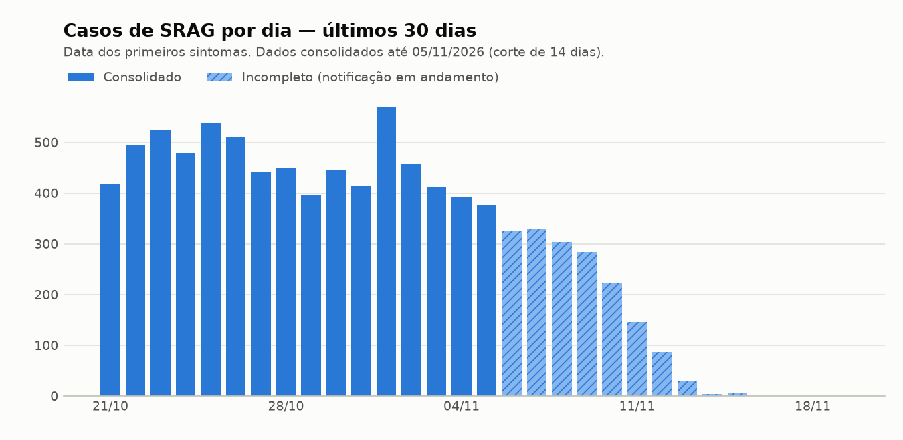
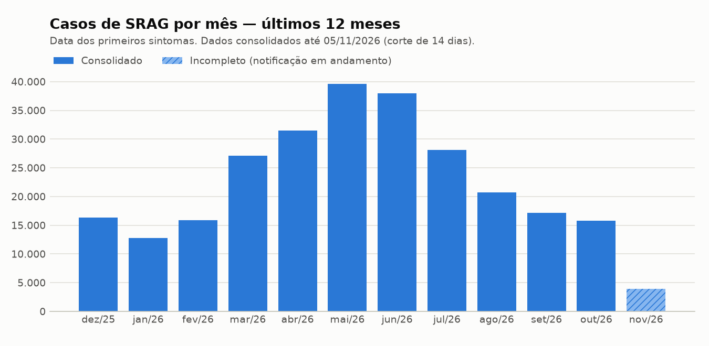

# Relatório de SRAG — 19/11/2026

Dados consolidados até 05/11/2026 (fonte: Open DATASUS, SIVEP-Gripe).

## Métricas

| Métrica | Valor | Detalhe |
|---|---|---|
| Taxa de aumento de casos (28 dias) | -11,5% | 13.737 vs 15.514 casos nos 28 dias anteriores |
| Taxa de aumento de casos (7 dias) | -8,1% | 3.068 vs 3.338 casos |
| Taxa de mortalidade (28 dias até 05/11/2026) | 4,5% | 343 óbitos em 7.693 casos com desfecho; 44,0% do período ainda sem desfecho |
| Internados em UTI (28 dias até 05/11/2026) | 29,3% | 3.462 de 11.819 internados (indicador de gravidade, não de leitos) |
| Vacinação registrada nos casos, gripe (28 dias até 05/11/2026) | 40,3% | entre os casos que informaram, não é cobertura da população |
| Vacinação registrada nos casos, COVID-19 (28 dias até 05/11/2026) | 40,6% | entre os casos que informaram, não é cobertura da população |

## Gráficos

## Cenário

_Texto gerado por IA a partir das métricas e manchetes acima; revise antes de usar._

Os dados consolidados até 05/11/2026 registram 13.737 casos de SRAG nos últimos 28 dias, contra 15.514 nos 28 dias anteriores (queda de 11,5%). Como os casos mais recentes ainda estão sendo notificados, os números podem ser revisados. A mortalidade entre os casos com desfecho é de 4,5% (343 óbitos em 7.693 casos), mas 44,0% dos casos do período ainda não têm desfecho. A proporção de internados em UTI, de 29,3%, indica gravidade, não ocupação de leitos. Entre os casos, 40,3% tinham vacina contra gripe e 40,6% tinham vacina contra COVID-19 registrada; são proporções dos casos, não coberturas populacionais.

Notícias apontam movimentos divergentes. A Fiocruz, citada pela Fundação Perseu Abramo, relata aumento de casos graves de COVID-19 no país, enquanto o total de casos de SRAG caiu. Em Rondônia, Ariquemes Online e Diário da Amazônia noticiam alta de 33% nas internações por doenças respiratórias, com maioria de crianças menores de cinco anos. No Amazonas, a FVS, segundo a 18 Horas, aponta queda de 22,9% nos casos por vírus respiratórios em 2026. Essas fontes usam recortes e bases diferentes, por isso não devem ser comparadas diretamente às métricas nacionais.

## Notícias consideradas

- 19/11/2026 — viuitauna: [Aumentos de casos de COVID-19 e óbito por SRAG em Itaúna reforçam importância da prevenção](https://news.google.com/rss/articles/CBMixgFBVV95cUxPbXpiWVA2MHpyV2ZGV0M5UmxWdjVfMGtWVjNILUNNZTIyWVRINkx2T2h2cWw1X0xreXcyeFduSDhTOFR4VlJpeXEwcjI0UzAtMndNZVQtN1pjQkJ1S3pUOXNhMVZWTEhCMFZTVnRqdzY4cnRtZTVWQ19hckY3NWQwRzdfRDgweVFqUzJ3LUgzTzRjQWlvSV9ESnl2blB3amhjdnlRZHEzQkVvdXNoLWk2T09aX1ZnNXJZb0Y0ZUVWYkJtd1V1cmc?oc=5)
- 19/11/2026 — 18 Horas / Rádio Mix Manaus: [Casos por vírus respiratórios caem 22,9% no Amazonas em 2026, aponta FVS](https://news.google.com/rss/articles/CBMipAFBVV95cUxObVVRUzF1QWk0YnJqNzAyT0dTTFlobEFfUEVMNU1tdFNPN212bEtFbm93d2lfSFNvOVFGLUhyQXloNjJ3UjRxUHB6cjVMS2phRUdfV2ViSzd5NW1FZGNsMWY4MUhSOVRXTktCYTViOEl2M3Y3MkhTQzZEVEZVWDU0RmoxbHBYTS1Va1RtRGtscDhReERIMVg4d3NwUnNFaUpXUzVvdQ?oc=5)
- 19/11/2026 — Ariquemes Online: [Internações por doenças respiratórias aumentam 33% em Rondônia; crianças menores de cinco anos concentram maioria dos casos](https://news.google.com/rss/articles/CBMi-wFBVV95cUxQLUZEU05lQlViRW4xTDhnYUdJajhZeTljNUd4TmtmcFZkRjhIcGxIWmRDVDNVWVBBaE9ZRU9hMnc5V3VtLWQwUDJYZlJCVTRWRFZPVURFUktEUmV2SFB4Qmw4S2dkenVNeUh0eVpmR2JqdmJzQ3VDMlo1VEJvMVpwTnctYmoxRlFpRUcybkNkUVhCWXpTWllhWC1BUkppU2VGZDRPS3lvNF9BaVl4YzBRaWhib2hOclZtVXA3cFdzMjhqYlhNY3dkSXF2UzRQSFBySkZfME5qRU1OV3E5bWJPWi1LT2ZvUXpYSVBjUHNGSjhua09PVS04a3ZSaw?oc=5)
- 19/11/2026 — Diário da Amazônia: [Internações por doenças respiratórias aumentam 33% em Rondônia e crianças são maioria dos casos](https://news.google.com/rss/articles/CBMi2wFBVV95cUxQb3JROVpKWGhISktfQUV5RkYyb2FSQWt5dGk0S1NmOXJQa2sxbE5JLVhkUEVJa21tX2tTQ2wzdlNCSnlWYzNfdzR6WTNING1VTDhPaXZrbEUyZUJRMlFGYzRmVjFiczJ4dFdnU2dpbXhMa1BwM2hTejJLeDg5X3ZuZzFtaXhFbGNVYzgtbXBxYXlDeDJVU3JYc2M2YXJSdGZLOFEtdDlQMVcxMFFyWk4xY1cwOUNUa19uODY2S2F3bUZFR1I2QkN6M3JWWko3aUxkcFpVdm9wWS13eVE?oc=5)
- 18/11/2026 — Portal Correio: [Paraíba receberá novo lote de vacinas contra a Covid-19](https://news.google.com/rss/articles/CBMijgFBVV95cUxOaVBjbmliLUJkMTJFSDRkTjQ1aXBqTjh0Q2pzdGYyT0NEQ0ttdURNQ2dTVzFqaDMwSlRsdTU1a28yWG04T1NQSUhxc1NOSzlyZ0FOalJDZTg2MThuelV4NVVxUVMwWURDclhDckdqSGF5WXB0aGM0YlVvcERDME5VYTJVU1BmWTh3V3N4SklB?oc=5)
- 18/11/2026 — ABC Repórter: [Reconhecer sintomas da Síndrome Respiratória Aguda Grave evita complicações](https://news.google.com/rss/articles/CBMitAFBVV95cUxNN3IwRkd1UEFjcGtRMzVocHBycXA0UVhVNEsweFg5VVhpb0J5Y21tb1ExdTRYR3NPX1hxbzE5UW1hRWNxTnJ1N3ZLMlRMVlRJekVER1FleUhsM056ODV0bGZIQnZCTkNEVkU3SmhYRkFMQ3FCWFp0SEZpV3I1V1Y1MGJwVmpHNzJaal9WZEYxLU5TaHlsXzd0S1J6eGxjSVE3aW5lTjJycERzWXd5VU5yVW1Sd0M?oc=5)
- 18/11/2026 — Tudo Rondônia: [Agevisa reforça vigilância de vírus respiratórios e vacinação](https://news.google.com/rss/articles/CBMisgFBVV95cUxOMDNnYzQ4MEpDQjZUX1NZTHJPOFMzYWczNXg3U1dPYVpuYmpsdU5Oa1U3UU0wUWQ3Y0MySGdabnpMalVydkM5OTJPakFzNDMtN19XYlBmX3haTkdkNWpLbllfdHJ5bnlhUkNtUXJYVEF1VVVmR2s5QVBBOE9QSUtIZFJZaWhIdnpvdEUzVGRPS2dBazJXU1RTT3RJNnZ2NlFteUhQN2hoWU9NWHlWenozRDhn?oc=5)
- 17/11/2026 — Fundação Perseu Abramo: [Casos graves de Covid-19 aumentam no país, aponta Fiocruz](https://news.google.com/rss/articles/CBMiakFVX3lxTFBEYlFSckktNWppSDVSS2J0ekNwOW1kTGlRcUtnQWhhcndkLXZhTWY0Ni1FTWFPR2JzTi1NNGVwSFhaYW1fZmxwM2J0ekIxZVF6TGhBSTRYVkFLSS1wem5wUk9oNDZwZkk2UXc?oc=5)

## Limitações

- Casos recentes ainda estão sendo notificados: as métricas usam um corte de 14 dias e a taxa pode estar levemente subestimada.
- A mortalidade considera apenas casos com desfecho registrado; os demais ainda podem evoluir.
- A proporção em UTI indica gravidade entre os internados; o conjunto de dados não informa o número de leitos.
- A vacinação é a proporção entre os casos de SRAG, não a cobertura vacinal da população.
- As notícias são manchetes de fontes públicas e não substituem boletins oficiais.
